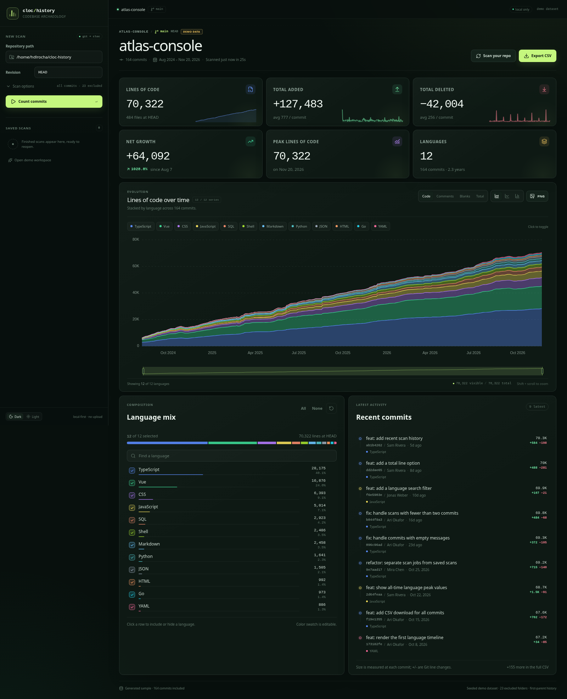

# cloc/history

A local-first dashboard that turns a Git repository into a commit-by-commit
history of its size. Each commit is counted language by language with
[cloc](https://github.com/AlDanial/cloc), then rendered as an interactive,
customizable timeline.



## Features

- **Full commit history** — counts every commit reachable from a branch, tag,
  or commit, or just the first-parent line.
- **Parallel scanning** — count large histories with a configurable pool of up
  to 16 cloc processes.
- **Language-aware charts** — stacked areas, lines, or bars. Every language gets
  its own color, legend label, share bar, and filter control.
- **Customizable view** — switch between code, comments, blank lines, and total
  lines; choose chart style and color theme; recolor any language.
- **Exclusions that fit your repo** — edit the folder exclusion list per scan
  (`node_modules`, `bin`, `third_party`, `vendor`, ...). Excluded names match at
  any depth.
- **Line churn totals** — total lines added and deleted, summed across every
  scanned commit and shown alongside project size.
- **Exports** — download a high-resolution PNG chart (with title and legend) or
  a CSV containing totals plus code/comment/blank/file counts for every language
  at every commit, plus Git additions/deletions.
- **Saved scans** — completed scans are stored locally and reopen automatically.
  Delete them from the sidebar when no longer needed.
- **CLI** — run the same scanner headlessly and write CSV/JSON for automation.
- **Demo workspace** — explore the UI with generated sample data before scanning.

## Requirements

- **Node.js 20.19+**
- **Git**
- **cloc** on your `PATH`

Install cloc:

```bash
# Debian / Ubuntu / Linux Mint
sudo apt install cloc

# macOS
brew install cloc

# Windows (Chocolatey)
choco install cloc
```

## Quick start

```bash
npm install
npm run dev
```

Open **http://127.0.0.1:5173** and enter the path to a local Git repository in
the sidebar. The API runs on port `3001` and Vite proxies `/api` to it.

For a production-style run:

```bash
npm run build
npm start
```

Then open **http://127.0.0.1:3001**.

## Scanning a repository

Fill in:

| Field | Description |
| --- | --- |
| **Repository path** | Absolute path to a local Git repository. |
| **Revision** | Branch, tag, or commit. Defaults to `HEAD`. |
| **Excluded folders** | Folder names skipped at any depth. One per line or comma-separated. |
| **First-parent history** | Follow only the first parent of merges for a cleaner mainline. |
| **Latest commits only** | Limit a very large scan to the latest N commits. `0` means all. |
| **Parallel cloc jobs** | Number of concurrent cloc processes (1–16). More jobs scan faster but use more CPU. |

Counting runs asynchronously, with progress for every commit. Scans can be
cancelled. Results are saved under `.data/scans/` and appear in the sidebar.

> Large repositories with thousands of commits will take a while because every
> commit is counted independently. Use **Latest commits only** for a quick
> snapshot. Commits that share the same Git tree reuse the previous count.

## Dashboard

- **Timeline** — stacked area (default), stacked lines, or stacked bars. The
  metric switch applies to the chart, stats, language mix, and recent commits.
- **Language chips** — click a label above the chart to show or hide that series.
  Use **All / None** in the Language mix panel for bulk selection.
- **Language mix** — current composition at `HEAD`; percentages are of the
  selected metric across all languages. Click a row to toggle it. Click the
  pipette icon on hover to assign a custom color (saved in `localStorage`).
- **Recent commits** — latest nine commits with their metric value, Git
  additions/deletions, and the language with the largest change.
- **Churn summary** — totals for every added and deleted line across the scan,
  plus per-commit averages, alongside current size and net growth.
- **Export CSV** — every commit, every language, all metrics, plus Git
  `added`/`deleted`/`changed_files`. This is independent of the chart's current
  language filter.
- **PNG** — exports the current chart with the selected metric, visible
  languages, title, and legend.
- **History scope** — the timeline counts committed Git trees. Uncommitted or
  ignored working-tree changes are not included until they are committed.

## CLI

The CLI uses the same scanner and CSV format.

```bash
# Scan the current directory, write a dated CSV
npm run scan

# Scan another project
npm run scan -- --repo ../my-project

# Custom exclusions, mainline only, latest 100 commits
npm run scan -- \
  --repo ../my-project \
  --revision main \
  --exclude node_modules,dist,third_party \
  --first-parent \
  --max 100 \
  --jobs 8 \
  --out history.csv

# Also retain the raw data, or pipe CSV to stdout
npm run scan -- --repo . --json scan.json --out -
```

Run `npm run scan -- --help` for all options.

### CSV shape

One row per commit. The leading columns are:

```text
date,sha,short_sha,author,email,subject,code,comment,blank,total_lines,files,added,deleted,changed_files
```

`added` and `deleted` are Git line changes for that commit (against its first
parent for merge commits), filtered by the configured folder exclusions. They
are followed by four columns for every language encountered:

```text
<Language> code,<Language> comment,<Language> blank,<Language> files
```

The file is UTF-8 with a BOM for spreadsheet compatibility.

## Configuration

| Environment variable | Default | Purpose |
| --- | --- | --- |
| `PORT` | `3001` | API / production web server port. |
| `HOST` | `127.0.0.1` | Bind address. Keep the default for local-only use. |
| `CLOC_HISTORY_DATA` | `.data` | Directory for saved scan snapshots. |
| `CLOC_HISTORY_REPO` | current directory | Pre-filled repository path in the UI. |
| `CLOC_HISTORY_JOBS` | up to 6 | Default parallel cloc processes (1–16). Also editable per scan. |

The Vite dev server proxies to `PORT` from the environment when it starts.

### Local files and privacy

Everything runs on your machine. The server can read any path you submit, so do
not expose it to an untrusted network. `HOST=0.0.0.0` is possible but
intentionally not the default.

## How it works

1. Resolve the repository root and the commit list with `git log`.
2. Collect per-commit Git additions/deletions with `git log --numstat`,
   excluding configured folders.
3. For each commit, run `cloc --git --json --quiet --exclude-dir=... <sha>`.
4. Parse cloc's JSON, normalize totals, and cache counts by Git tree hash.
5. Persist the scan result and build the dashboard/CSV/PNG from that snapshot.

The chart is rendered with [ECharts](https://echarts.apache.org/); PNG export
uses a dedicated off-screen render with a title and native legend so the image
is self-contained.

## Project structure

```text
server/
  index.mjs      Express API, scan jobs, saved scans, static production build
  scanner.mjs    Git + cloc scanner, caching, CSV formatter
  demo.mjs       Deterministic demo dataset
scripts/
  cloc-history.mjs   Headless CLI
src/
  App.vue            Dashboard state and layout
  components/        Sidebar, chart, language mix, progress, etc.
  utils/             Formatting, language colors, CSV/PNG downloads
test/
  scanner.test.mjs   CSV and demo dataset invariants
```

## Development

```bash
npm run dev        # API + Vite with hot reload
npm run test       # node:test checks for CSV and demo data
npm run check      # syntax checks + tests + production build
npm run build      # build the Vue app into dist/
npm start          # serve the API and built app
npm run scan -- --help
```

## Notes and limitations

- Exclusions are folder names, not glob patterns. A folder named `dist` is
  skipped wherever it appears; `.git` is always skipped.
- Added/deleted totals use Git's line-diff `--numstat` output. They include all
  text-file changes outside excluded folders (not just languages recognized by
  cloc). Binary files contribute to `changed_files` but not line counts. Because
  they include comments and blank lines, `added − deleted` does not necessarily
  equal the code-only line count shown by cloc.
- Merge commits are counted as their resulting tree unless you enable
  first-parent mode. For churn, merge commits are diffed against their first
  parent. Tree caching avoids recounting unchanged merge trees.
- The timeline reflects committed history. Uncommitted changes in the working
  tree are intentionally excluded.
- cloc only counts file types it recognizes. Languages not supported by cloc
  won't appear.
- Author/committer dates come from Git. The timeline follows commit order.
- Demo data is generated locally and is clearly labeled; it never touches a
  repository.

## License

MIT
